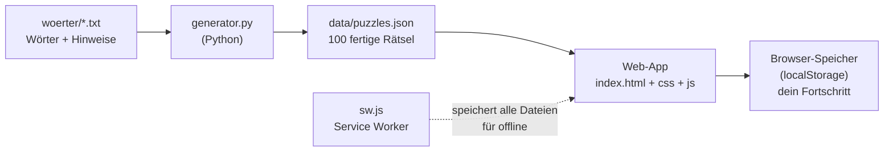

# 00 – Überblick: Wie alles zusammenhängt

Diese Doku erklärt das ganze Projekt so, dass du jede Zeile verstehst. Sie setzt voraus, was du schon kannst (Python-Grundlagen, etwas JavaScript vom Arduino, etwas HTML/CSS/YAML) und erklärt alles darüber hinaus.

## Die Idee in einem Satz

Ein **Python-Programm** baut einmalig 100 Rätsel und speichert sie als **JSON-Datei**. Eine **Webseite** (HTML + CSS + JavaScript) lädt diese Datei und lässt dich die Rätsel spielen. Ein **Service Worker** sorgt dafür, dass die Webseite auch ohne Internet funktioniert, deshalb kann sie auf dem iPhone wie eine App laufen.



Wichtig ist die **Trennung in zwei Welten**:

| | Generator (Python) | App (HTML/CSS/JS) |
|---|---|---|
| Läuft wo? | Auf deinem PC, nur wenn du neue Rätsel willst | Im Browser, jedes Mal beim Spielen |
| Braucht was? | Python 3 | Nur einen Browser |
| Ergebnis | `data/puzzles.json` | Das Spiel auf dem Bildschirm |
| Schwierig, weil | Rätsel bauen ist ein Suchproblem | Bedienung muss sich gut anfühlen |

Die App rechnet also nichts Kompliziertes. Sie zeigt fertige Rätsel an und prüft deine Eingaben. Die ganze "Intelligenz" steckt im Generator.

## Die Dateien

```
kreuzwortraetsel/
├── index.html              Gerüst: Startseite, Spielseite, Dialoge
├── manifest.webmanifest    Name, Icon, Farben für "Zum Home-Bildschirm"
├── sw.js                   Service Worker (offline)
├── css/
│   └── style.css           Aussehen
├── js/
│   ├── app.js              Startpunkt, Seitenwechsel, Startseite
│   ├── spiel.js            Ein Rätsel spielen (die größte Datei)
│   ├── speicher.js         Spielstand speichern
│   └── tastatur.js         Bildschirmtastatur
├── data/
│   └── puzzles.json        Die Rätsel (vom Generator erzeugt)
├── fonts/
│   ├── archivo-latin.woff2 Die Schrift
│   └── OFL.txt             Lizenz der Schrift
├── icons/                  App-Icons in verschiedenen Größen
├── generator/
│   ├── generator.py        Der Rätsel-Generator
│   └── woerter/*.txt       Die Wortlisten
└── docs/                   Diese Doku
```

## Was passiert, wenn du die App öffnest?

Schritt für Schritt, damit du später im Code weißt, wo du bist:

1. Der Browser lädt `index.html`. Darin steht, welche CSS-Datei und welches Skript dazugehören.
2. `css/style.css` wird geladen. Die Seite bekommt Farben und Layout.
3. `js/app.js` startet. Es lädt `data/puzzles.json` und meldet den Service Worker `sw.js` an.
4. `app.js` schaut in die Adresse (URL). Steht dort `#/spiel/mittel-04`, öffnet es dieses Rätsel. Sonst zeigt es die Startseite.
5. Beim Öffnen eines Rätsels erzeugt `app.js` ein Objekt der Klasse `Spiel` aus `spiel.js`. Dieses Objekt zeichnet das Gitter und kümmert sich ab jetzt um alles im Rätsel.
6. Jede Eingabe landet in `Spiel`, wird angezeigt und über `speicher.js` im Browser gespeichert.
7. Der Service Worker legt im Hintergrund eine Kopie aller Dateien an. Beim nächsten Öffnen kommt alles aus dieser Kopie, auch ohne Internet.

## Lokal starten

Doppelklick auf `index.html` funktioniert **nicht**. Der Browser blockiert dann aus Sicherheitsgründen das Laden von JavaScript-Modulen und der JSON-Datei, weil die Adresse mit `file://` beginnt. Du brauchst einen kleinen Webserver. Python hat einen eingebaut:

```bash
cd kreuzwortraetsel
python -m http.server 8000
```

- `python -m http.server` startet das eingebaute Modul `http.server` als Programm.
- `8000` ist der Port. Du kannst jede freie Zahl nehmen.

Dann <http://localhost:8000> im Browser öffnen. `Strg + C` im Terminal beendet den Server.

> **Hinweis zum Service Worker beim Entwickeln:** Weil der Service Worker Dateien zwischenspeichert, siehst du Änderungen manchmal erst beim zweiten Neuladen. In Chrome hilft: F12 → Reiter "Application" → "Service Workers" → Haken bei "Update on reload". Mehr dazu in [06 – PWA und Offline](06-pwa-offline.md).

## Neue Rätsel erzeugen

```bash
cd generator
python generator.py
```

Das dauert ein paar Minuten (bei mir gut 5) und überschreibt `data/puzzles.json`. Achtung: Dein gespeicherter Fortschritt hängt an den Rätsel-IDs (`leicht-01` usw.). Erzeugst du neue Rätsel, passen alte Spielstände nicht mehr zu den neuen Gittern. Dann einfach auf der Startseite "Gesamten Fortschritt löschen".

## Lernpfad

Die Kapitel bauen aufeinander auf. Wenn du nur eins liest, lies das Generator-Kapitel, da steckt die spannendste Logik drin.

| Kapitel | Thema | Dauer (grob) |
|---|---|---|
| [01 – Wortliste](01-wortliste.md) | Datenformat, Level, gute Hinweise | 10 min |
| [02 – Generator](02-generator.md) | Backtracking, Suche, Python-Techniken | 60–90 min |
| [03 – HTML](03-html.md) | Gerüst der Seite, Dialoge, Barrierefreiheit | 20 min |
| [04 – CSS](04-css.md) | Variablen, Grid, Flexbox, Dunkelmodus, iPhone-Eigenheiten | 40 min |
| [05 – JavaScript](05-javascript.md) | Module, Klassen, DOM, Events, Speichern | 60–90 min |
| [06 – PWA und Offline](06-pwa-offline.md) | Manifest, Service Worker, iPhone | 20 min |
| [07 – Git und GitHub Pages](07-git-github-pages.md) | Veröffentlichen und Änderungen hochladen | 20 min |
| [08 – Übungen](08-uebungen.md) | Selbst weiterbauen | so lange du willst |

## Begriffe, die immer wieder vorkommen

| Begriff | Bedeutung |
|---|---|
| **Hinweisfeld** | Feld mit dem Rätseltext (blau). Im Code `#`. |
| **Buchstabenfeld** | Feld, in das ein Buchstabe kommt. |
| **Wort / Lauf** | Waagerechte oder senkrechte Folge von mindestens 2 Buchstabenfeldern. |
| **Pfeil** | Sagt, wo das Wort zum Hinweis beginnt und in welche Richtung es läuft. |
| **Schablone / Muster** | Ein Gitter, in dem nur feststeht, wo Hinweis- und wo Buchstabenfelder sind. |
| **Backtracking** | Suchverfahren: ausprobieren, bei Sackgasse zurückgehen, anders probieren. |
| **DOM** | Die Baumstruktur der HTML-Elemente, die JavaScript verändern kann. |
| **Event** | Ein Ereignis wie Klick oder Tastendruck, auf das Code reagieren kann. |
| **PWA** | Progressive Web App: eine Webseite, die sich wie eine App installieren lässt. |
