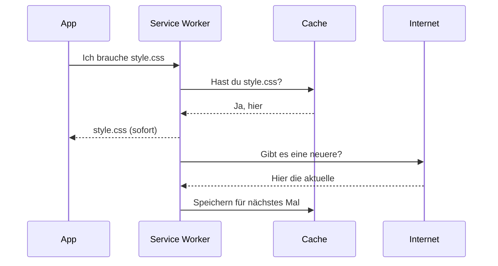

# 06 – Offline und iPhone: PWA und Service Worker

Eine **Progressive Web App (PWA)** ist eine normale Webseite mit drei Extras:

1. einem **Manifest** (Name, Icon, Farben),
2. einem **Service Worker** (macht sie offline-fähig),
3. Auslieferung über **HTTPS** (verschlüsselt).

Erfüllt eine Seite das, lässt sie sich wie eine App auf den Home-Bildschirm legen, startet ohne Browserleisten und läuft ohne Internet. Keine App-Store-Prüfung, keine 99 € im Jahr für Apple, kein Neuinstallieren alle 7 Tage.

## Das Manifest

Datei: `manifest.webmanifest`. Eine JSON-Datei:

```json
{
  "name": "Schwedenrätsel",
  "short_name": "Rätsel",
  "description": "100 Schwedenrätsel in drei Schwierigkeitsgraden, offline spielbar.",
  "lang": "de",
  "start_url": "./",
  "scope": "./",
  "display": "standalone",
  "orientation": "portrait",
  "background_color": "#F5F7F6",
  "theme_color": "#F5F7F6",
  "icons": [
    { "src": "icons/icon-192.png", "sizes": "192x192", "type": "image/png" },
    { "src": "icons/icon-512.png", "sizes": "512x512", "type": "image/png" },
    { "src": "icons/icon-maskable-512.png", "sizes": "512x512", "type": "image/png", "purpose": "maskable" }
  ]
}
```

| Feld | Bedeutung |
|---|---|
| `name` / `short_name` | Voller Name, und der kurze unter dem Icon |
| `start_url` | Welche Seite beim Start der App geöffnet wird. `./` = der Ordner, in dem das Manifest liegt |
| `scope` | Welche Adressen zur App gehören. Alles außerhalb öffnet sich im normalen Browser |
| `display: standalone` | Ohne Adressleiste und Browser-Knöpfe, wie eine echte App |
| `orientation` | Hochformat bevorzugt |
| `background_color` | Hintergrund des Startbildschirms, bis die App geladen ist |
| `theme_color` | Farbe der Statusleiste |
| `icons` | Icons in mehreren Größen. `maskable` ist eine Variante mit mehr Rand: Android schneidet Icons je nach Hersteller rund, eckig oder als Tropfen zu, und das Wichtige muss in der Mitte bleiben |

Die Pfade sind **relativ** (`./`, `icons/…`). Das ist wichtig für GitHub Pages: Dort liegt die App nicht unter `/`, sondern unter `/kreuzwortraetsel/`. Mit absoluten Pfaden (`/icons/…`) würde nichts gefunden.

Die Icons hat übrigens ein kleines Python-Skript mit der Bildbibliothek Pillow gezeichnet: ein 2×2-Rätselgitter mit blauem Hinweisfeld, Pfeil, gelb markiertem R und den Buchstaben Ä und T.

## Der Service Worker

Datei: `sw.js`. Ein Service Worker ist ein JavaScript, das der Browser **getrennt von der Seite** im Hintergrund laufen lässt. Er sitzt wie ein Türsteher zwischen App und Internet: Jede Anfrage der App ("gib mir `css/style.css`") geht zuerst an ihn, und er entscheidet, woher die Antwort kommt.



### Lebenszyklus

Ein Service Worker durchläuft drei Phasen. Für jede gibt es ein Ereignis:

**1. `install`** – einmal, wenn eine neue Version von `sw.js` entdeckt wird.

```js
const VERSION = "v1";
const CACHE_NAME = `schwedenraetsel-${VERSION}`;
const DATEIEN = ["./", "index.html", "css/style.css", "js/app.js", ...];

self.addEventListener("install", (ereignis) => {
  ereignis.waitUntil(
    caches.open(CACHE_NAME)
      .then((cache) => cache.addAll(DATEIEN))
      .then(() => self.skipWaiting()),
  );
});
```

- `self` ist im Service Worker das, was in der Seite `window` ist: das globale Objekt.
- `caches` ist ein eingebauter Speicher für ganze HTTP-Antworten (die **Cache Storage API**). Getrennt von `localStorage`, und er kann auch große Dateien.
- `cache.addAll(DATEIEN)` lädt alle Dateien aus der Liste und legt sie ab. Schlägt eine fehl (Tippfehler im Namen!), schlägt die ganze Installation fehl. Also: Neue Dateien immer in diese Liste eintragen.
- `ereignis.waitUntil(promise)` sagt dem Browser: "Die Installation ist erst fertig, wenn dieses Promise erfüllt ist." Sonst könnte er den Worker mittendrin beenden.
- `.then(...).then(...)` ist eine **Promise-Kette**: erst den Cache öffnen, dann die Dateien hineinladen, dann `skipWaiting()`.
- `skipWaiting()`: Normalerweise wartet ein neuer Service Worker, bis alle Tabs mit der alten Version geschlossen sind. Das sparen wir uns. Für ein Rätselspiel ist es unkritisch, sofort umzuschalten.

**2. `activate`** – wenn der neue Worker übernimmt. Zeit zum Aufräumen:

```js
self.addEventListener("activate", (ereignis) => {
  ereignis.waitUntil(
    caches.keys()
      .then((namen) => Promise.all(
        namen.filter((name) => name !== CACHE_NAME).map((name) => caches.delete(name)),
      ))
      .then(() => self.clients.claim()),
  );
});
```

- `caches.keys()` liefert die Namen aller Caches dieser Seite.
- Alle, die nicht `schwedenraetsel-v1` heißen (also alte Versionen), werden gelöscht.
- `Promise.all([...])` wartet, bis **alle** Löschvorgänge fertig sind.
- `clients.claim()` übernimmt sofort auch die bereits offenen Seiten.

**3. `fetch`** – bei jeder einzelnen Anfrage der App:

```js
self.addEventListener("fetch", (ereignis) => {
  const anfrage = ereignis.request;
  if (anfrage.method !== "GET") return;
  if (new URL(anfrage.url).origin !== self.location.origin) return;

  ereignis.respondWith((async () => {
    const cache = await caches.open(CACHE_NAME);
    const ausCache = await cache.match(anfrage, { ignoreSearch: true });

    const ausNetz = fetch(anfrage)
      .then((antwort) => {
        if (antwort.ok) cache.put(anfrage, antwort.clone());
        return antwort;
      })
      .catch(() => ausCache);

    if (ausCache) {
      ereignis.waitUntil(ausNetz);
      return ausCache;
    }
    return ausNetz;
  })());
});
```

Zeile für Zeile:

- Nur `GET`-Anfragen (Lesen) cachen. Nur eigene Dateien, nicht fremde Server.
- `ereignis.respondWith(...)` heißt: "Ich beantworte diese Anfrage selbst." Es erwartet ein Promise, das eine Antwort liefert.
- `(async () => { ... })()` ist eine **sofort aufgerufene** asynchrone Funktion. Sie erlaubt `await` und gibt automatisch ein Promise zurück.
- `cache.match(anfrage, { ignoreSearch: true })` sucht die Datei im Cache. `ignoreSearch` ignoriert Anhänge wie `?v=2` in der Adresse.
- Gleichzeitig startet `fetch(anfrage)` die Anfrage ans Netz. Klappt sie, kommt eine **Kopie** (`clone()`) in den Cache. Kopie deshalb, weil man den Inhalt einer Antwort nur **einmal** lesen kann: einmal für den Cache, einmal für die App.
- `.catch(() => ausCache)`: Kein Internet → nimm, was im Cache ist.
- Ist die Datei im Cache, liefern wir sie **sofort** aus und lassen die Netz-Anfrage im Hintergrund weiterlaufen (`waitUntil`, damit der Browser den Worker nicht vorher beendet).
- Ist sie nicht im Cache (allererster Besuch), warten wir aufs Netz.

Diese Strategie heißt **stale-while-revalidate**: "Liefere das Alte sofort, hol nebenbei das Neue." Vorteil: Die App startet immer blitzschnell, auch mit schlechtem Netz. Nachteil: Nach einem Update siehst du die neue Version erst beim **zweiten** Öffnen.

### Updates ausrollen

Wenn du die App änderst und hochlädst:

1. Bei kleinen Änderungen: nichts weiter tun. Beim nächsten Öffnen lädt der Service Worker im Hintergrund die neuen Dateien, beim übernächsten siehst du sie.
2. Bei größeren Änderungen oder neuen Dateien: in `sw.js` die `VERSION` hochzählen (`"v2"`) und neue Dateien in `DATEIEN` eintragen. Der Browser erkennt, dass sich `sw.js` geändert hat, installiert den neuen Worker, und der löscht den alten Cache.

Neue Rätsel (`puzzles.json`) werden über den normalen Hintergrund-Abgleich aktualisiert.

### Service Worker beim Entwickeln

Der Cache kann beim Entwickeln nerven ("Ich hab doch was geändert, warum sehe ich nichts?"). In Chrome:

- F12 → **Application** → **Service Workers** → Haken bei **Update on reload**. Dann wird bei jedem Neuladen alles frisch geholt.
- Oder: F12 → Application → **Storage** → **Clear site data**.

Service Worker laufen nur auf `https://` oder auf `localhost`. Deshalb geht das Testen mit `python -m http.server` problemlos, aber nicht übers WLAN mit der IP-Adresse deines PCs (`http://192.168.…`).

## Aufs iPhone

1. Die GitHub-Pages-Adresse in **Safari** öffnen (andere Browser auf dem iPhone können es inzwischen auch, Safari ist am zuverlässigsten).
2. Unten auf das **Teilen-Symbol** tippen (Quadrat mit Pfeil nach oben).
3. **Zum Home-Bildschirm** wählen, Namen bestätigen.
4. Die App vom Home-Bildschirm aus starten. Einmal mit Internet öffnen, dann ist alles im Cache, und sie läuft auch im Flugmodus.

Gut zu wissen beim iPhone:

- **Die Home-Bildschirm-App hat ihren eigenen Speicher**, getrennt vom Safari-Tab. Fortschritt aus dem Safari-Tab ist in der App also nicht da (und umgekehrt). Am besten nur noch die App benutzen.
- In normalen Safari-Tabs löscht iOS Website-Daten, wenn man die Seite 7 Tage nicht benutzt hat. **Für Apps auf dem Home-Bildschirm gilt das nicht.** Ein Grund mehr, sie dort abzulegen.
- Löschst du die App vom Home-Bildschirm, ist auch der Spielstand weg.

## Was die PWA nicht kann (und hier nicht braucht)

| Funktion | Status |
|---|---|
| Offline spielen | ja |
| Eigenes Icon, Vollbild | ja |
| Spielstand speichern | ja (nur auf dem Gerät) |
| Spielstand zwischen Geräten abgleichen | nein, bräuchte einen Server |
| Im App Store erscheinen | nein, ist auch nicht nötig |
| Push-Benachrichtigungen | auf dem iPhone möglich, aber hier nicht eingebaut |
