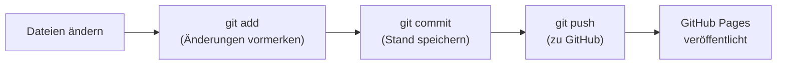

# 07 – Git und GitHub Pages

## Wie die App ins Internet kommt

**GitHub Pages** veröffentlicht die Dateien eines GitHub-Repos kostenlos als Webseite, mit HTTPS (Pflicht für den Service Worker). Du lädst Dateien hoch, ein paar Sekunden später sind sie online. Es gibt keinen Server, den du pflegen musst, weil die App nur aus "statischen" Dateien besteht (HTML, CSS, JS, JSON, Bilder).

| | |
|---|---|
| Repo | `github.com/Schmitzzz/kreuzwortraetsel` |
| Adresse der App | `https://schmitzzz.github.io/kreuzwortraetsel/` |
| Kosten | 0 € |
| Bedingung | Das Repo muss **öffentlich** sein (bei kostenlosen Konten) |

Öffentlich heißt: Jeder kann den Code und die Rätsel sehen. Für dieses Projekt ist das unkritisch, es enthält nichts Persönliches. Dein Spielstand liegt nur auf deinem Gerät, nicht auf GitHub.

## GitHub Pages einschalten (einmalig)

1. Auf github.com das Repo `kreuzwortraetsel` öffnen.
2. Oben auf **Settings** (Zahnrad).
3. Links im Menü **Pages**.
4. Unter **Build and deployment** → **Source**: **Deploy from a branch**.
5. Unter **Branch**: `main` auswählen, daneben den Ordner `/ (root)`, dann **Save**.
6. Nach 1–2 Minuten steht oben auf derselben Seite: "Your site is live at https://schmitzzz.github.io/kreuzwortraetsel/".

Unter dem Reiter **Actions** im Repo siehst du, wie GitHub die Seite bei jeder Änderung neu veröffentlicht ("pages build and deployment").

## Git in 5 Minuten

Git ist eine **Versionsverwaltung**: Es merkt sich jeden Stand deines Projekts. Du kannst jederzeit zurück, siehst, was sich geändert hat, und kannst den Stand mit GitHub abgleichen.

Die wichtigsten Begriffe:

| Begriff | Bedeutung |
|---|---|
| **Repository (Repo)** | Ein Projektordner, den Git verwaltet (erkennbar am versteckten Ordner `.git`) |
| **Commit** | Ein gespeicherter Stand mit Beschreibung ("Neue Wörter hinzugefügt") |
| **Branch** | Ein Entwicklungszweig. Hier gibt es nur `main` |
| **Remote** | Die Kopie auf GitHub (heißt meist `origin`) |
| **Push** | Deine Commits zu GitHub hochladen |
| **Pull** | Commits von GitHub herunterladen |
| **Clone** | Ein Repo von GitHub zum ersten Mal herunterladen |

Der Kreislauf beim Arbeiten:



## Einrichtung auf deinem PC (einmalig)

Git ist auf deinem PC schon installiert. Es fehlen nur Name und E-Mail, die in jedem Commit stehen. In PowerShell:

```powershell
git config --global user.name "Felix"
git config --global user.email "DEINE-ID+Schmitzzz@users.noreply.github.com"
```

Für die E-Mail nimmst du am besten die **anonyme GitHub-Adresse**, damit deine echte E-Mail nicht öffentlich in jedem Commit steht. Du findest sie auf github.com unter **Settings → Emails** im Abschnitt "Keep my email addresses private" (sie sieht aus wie `12345678+Schmitzzz@users.noreply.github.com`).

`--global` heißt: gilt für alle Repos auf diesem PC.

## Das Projekt herunterladen

```powershell
cd $HOME\Projekte          # oder wo du deine Projekte ablegst
git clone https://github.com/Schmitzzz/kreuzwortraetsel.git
cd kreuzwortraetsel
```

`git clone` legt den Ordner `kreuzwortraetsel` an, mit allen Dateien und der kompletten Geschichte.

## Eine Änderung hochladen

Beispiel: Du hast neue Wörter in `generator/woerter/05-buchstaben.txt` geschrieben und neue Rätsel erzeugt.

```powershell
git status
```

Zeigt, was sich geändert hat (rot = geändert, noch nicht vorgemerkt).

```powershell
git diff
```

Zeigt die Änderungen Zeile für Zeile (`+` neu, `-` entfernt). Mit `q` beenden.

```powershell
git add generator/woerter/05-buchstaben.txt data/puzzles.json
```

Merkt diese Dateien für den nächsten Commit vor. `git add .` merkt alles im aktuellen Ordner vor.

```powershell
git commit -m "Neue Wörter rund um Mannheim, Rätsel neu erzeugt"
```

Speichert den Stand mit einer Beschreibung. Gute Beschreibungen sagen, **was** und **warum**, nicht wie.

```powershell
git push
```

Lädt hoch. Beim allerersten Mal öffnet sich ein Browserfenster, in dem du dich bei GitHub anmeldest ("Git Credential Manager"). Danach merkt sich Windows die Anmeldung.

Etwa eine Minute später ist die neue Version auf GitHub Pages. Auf dem iPhone die App zweimal öffnen (siehe Service Worker in Kapitel 06), dann ist sie aktuell.

## Nützliche Befehle

| Befehl | Was er tut |
|---|---|
| `git log --oneline` | Liste aller Commits, kurz |
| `git diff` | Was hat sich seit dem letzten Commit geändert? |
| `git restore datei.txt` | Änderungen an einer Datei verwerfen (Vorsicht: weg ist weg) |
| `git pull` | Neueste Version von GitHub holen (z. B. wenn ich etwas geändert habe) |
| `git show HEAD` | Was war im letzten Commit? |

## Die leere Datei `.nojekyll`

Im Hauptordner liegt eine leere Datei namens `.nojekyll`. GitHub Pages schickt normalerweise alle Dateien durch **Jekyll**, einen Generator für Blogs, der Markdown in Webseiten verwandelt und dabei Zeichen wie `{{` als Platzhalter deutet. Unsere App braucht das nicht, sie besteht aus fertigen Dateien. `.nojekyll` sagt GitHub: "Liefere alles genau so aus, wie es ist." Das ist schneller und schließt Überraschungen aus.

## Was nicht ins Repo gehört

Die Datei `.gitignore` listet Dateien auf, die Git ignorieren soll. Hier zum Beispiel Pythons Zwischenspeicher `__pycache__/`. Alles, was automatisch entsteht und sich jederzeit neu erzeugen lässt, gehört nicht ins Repo. Ausnahme: `data/puzzles.json` wird zwar erzeugt, muss aber ins Repo, weil GitHub Pages sie ausliefern soll und dort kein Python läuft.
